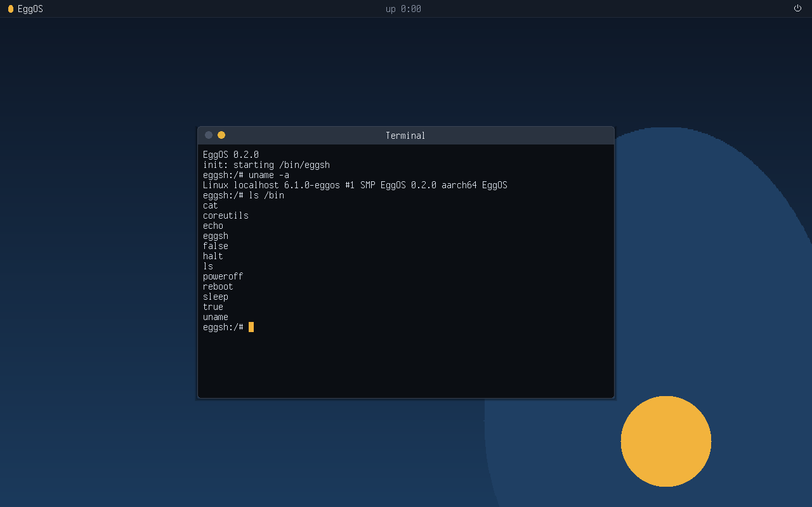

# EggOS
AI-native operating system written from scratch in Rust, with its own kernel (no Linux code) that can also run Linux programs unchanged.

- **Fast and light:** built to beat macOS, Windows and Linux on speed, memory and install size.
- **AI-native:** a built-in MCP server lets AI agents use the whole OS, and every app you install, with your permission.
- **CLI, GUI and AI at 100% parity:** anything you can do in one, you can do in the others.
- **Runs Windows, macOS, Android and iOS apps natively,** without emulation.
- **One OS for every device:** desktop, laptop, phone, tablet, TV, wearable, car, server, embedded.
- **Modular:** beyond a small base, every feature is optional, so you install only what you choose.
- **Editions:** personal, professional, enterprise and server.

100% open source under either the [MIT License](LICENSE-MIT) or the [Apache License 2.0](LICENSE-APACHE), at your option.

EggOS is open source and open for funding. If you want to help build it, [sponsor EggOS on GitHub Sponsors](https://github.com/sponsors/eggspot).

## Try EggOS
EggOS is pre-alpha: it boots in QEMU only, to a shell on a minimal desktop. These steps apply
from v0.3.0, the first release with the desktop, `SHA256SUMS` and the run scripts.



1. Install [QEMU](https://www.qemu.org/download/) (macOS: `brew install qemu`; Debian or Ubuntu:
   `sudo apt install qemu-system`; Windows: the QEMU installer, with its folder on `PATH`).
2. From the [latest release](https://github.com/eggspot/EggOS/releases/latest) (v0.3.0 or later), download into one
   folder the image for your machine (`eggos-<version>-aarch64.elf`, `-riscv64.elf` or
   `-x86_64.elf`), `SHA256SUMS`, and `run-eggos.sh` (macOS, Linux) or `run-eggos.ps1` (Windows).
3. Run the script. It picks your machine's architecture, checks the image against `SHA256SUMS`
   (`sha256sum -c --ignore-missing SHA256SUMS` or `shasum -a 256 -c --ignore-missing SHA256SUMS`
   checks it by hand) and boots it:

```
sh run-eggos.sh                       # a QEMU window with the desktop; the console here too
sh run-eggos.sh riscv64 --serial      # another architecture, no window: the console here only
.\run-eggos.ps1 -Arch x86_64 -Serial  # Windows PowerShell
```

On Windows, if PowerShell refuses to run a downloaded script, start it with
`powershell -ExecutionPolicy Bypass -File run-eggos.ps1`.

To use files from your computer, pass a folder: it appears read-only at `/media/host`, where
you can list it, read its files and run programs from it (`ls /media/host`, `cat`,
`/media/host/hello`). It must fit about 500 MB, with fewer than about 250 names at its top
level ([docs/limitations.md](docs/limitations.md)):

```
sh run-eggos.sh --apps ~/eggos-apps                  # macOS, Linux
.\run-eggos.ps1 -Apps C:\Users\me\eggos-apps         # Windows PowerShell
cargo xtask run --arch aarch64 --apps ~/eggos-apps    # from a checkout
```

The window shows the desktop: the top bar with the uptime and a power menu, and the `eggsh`
shell in a terminal window you can move, focus and minimise with the mouse. Type at the
`eggsh:/#` prompt there or on the terminal the script runs in: `ls`, `cat`, `echo`, `uname`,
`grep`, `wc`, `head`, `tail`, `ps`, `free`, `uptime`, pipes such as `ls /bin | grep s | wc -l`,
files in `/tmp` and `/home` (`echo hi > /tmp/x`, `cp`, `mv`, `rm`, `mkdir`, `touch`), the up
arrow for the last lines, and `poweroff` or `reboot` (the [shell](docs/shell.md) and the
[core utilities](docs/coreutils.md)). What you keep in `/home` and `/Applications` survives
a reboot: the script creates `eggos-<arch>-disk.img` next to the image (1 GiB, sparse) and
EggOS formats it with [EggFS](docs/eggfs.md), its own journaled file system, the first time;
`sync` writes changes at once, and they are written within 5 s anyway. `--disk <image>` uses
another image, `--no-disk` none (then `/home` is in memory and nothing is kept), and
`--format-disk` erases the image (`-Disk`, `-NoDisk` and `-FormatDisk` in PowerShell). Type
`settings` to open [Settings](docs/settings.md) and pick the Windows, macOS or Linux layout
profile (where the window controls are and which shortcuts work); it is kept on the disk.
Quit with Ctrl-A then X on that terminal, or close the
window. What does not work yet: [docs/limitations.md](docs/limitations.md).

### Run your own Linux programs
Static Linux programs run unmodified. From a checkout, add yours to the image and boot it, then
type its name at the prompt ([docs/linux-programs.md](docs/linux-programs.md)):

```
cargo xtask run --arch aarch64 --add path/to/hello     # boots with /bin/hello
cargo xtask image --arch all --add path/to/hello       # writes target/image/eggos-<arch>.elf
```

### Run Windows programs
On x86_64 (x64 programs) and aarch64 (ARM64 programs), Windows console programs and simple GUI
programs run natively through EggOS's own Windows layer, threads, waits, directory listing,
windows, GDI painting and message boxes included
([docs/windows-programs.md](docs/windows-programs.md) lists what they may use):

```
cargo xtask run --arch x86_64 --add path/to/hello.exe  # boots with /bin/hello.exe
cargo xtask run --arch aarch64 --add path/to/hello-arm64.exe
```

### Run Android console programs
On aarch64 and x86_64, static Android console programs built with the NDK run natively through
the Linux layer ([docs/android-programs.md](docs/android-programs.md) says how to build them and
what works):

```
cargo xtask run --arch aarch64 --add path/to/hello     # boots with /bin/hello and /system/bin/sh
```

### Run macOS console programs
On aarch64 (arm64 programs) and x86_64 (x86_64 programs), macOS console programs that link
only libSystem run natively through EggOS's own macOS layer, part 1
([docs/macos-programs.md](docs/macos-programs.md) lists what they may use):

```
cargo xtask run --arch aarch64 --add path/to/hello     # a thin or fat Mach-O file
```

## Layout
| Path | What |
|------|------|
| `kernel/` | architecture-independent kernel core and the kernel binary |
| `hal/` | hardware abstraction layer: the `Platform` trait and one module per architecture |
| `drivers/` | device drivers behind one driver model |
| `userland/` | our own Linux programs: init, the [shell](docs/shell.md), the [core utilities](docs/coreutils.md), [Settings](docs/settings.md), the GUI toolkit (`toolkit`) and the runtime they share |
| `tests/` | programs the boot tests add to the image: `linux-static`, an ordinary static Linux program ([Linux programs](docs/linux-programs.md)), `windows-console`, Windows console programs ([Windows programs](docs/windows-programs.md)), `android-console`, a static Android console program linked against bionic ([Android programs](docs/android-programs.md)), and `macos-console`, macOS console programs linked by Apple's linker ([macOS programs](docs/macos-programs.md)) |
| `xtask/` | developer commands (`cargo xtask ...`) |
| `docs/` | [roadmap](docs/roadmap.md), [decisions](docs/decisions.md), [dependencies](docs/dependencies.md), [UX research](docs/ux/README.md) |

## Build and test
Requires [rustup](https://rustup.rs); the pinned toolchain in `rust-toolchain.toml` installs itself.

```
cargo xtask ci                   # everything CI runs, cheapest first
cargo xtask qemu --arch all      # boot every architecture in QEMU headless, check the verdict
cargo xtask bench --arch all     # benchmarks (instruction counts), checked against benchmarks/baseline.txt
cargo xtask lint                 # comments the repository rules disallow (beyond xtask/lint-legacy-files.txt)
cargo xtask run --arch aarch64   # boot interactively: display in a window, console here (quit: Ctrl-A then X)
cargo xtask release              # the release files in target/release-dist/: images, SHA256SUMS, run scripts, notes
cargo xtask screenshot --arch aarch64   # docs/images/desktop.png from the release image's display
```
QEMU (`qemu-system-aarch64`, `qemu-system-riscv64`, `qemu-system-x86_64`) must be on `PATH` for the
boot commands.
Kernel architectures so far: aarch64, riscv64, x86_64.
